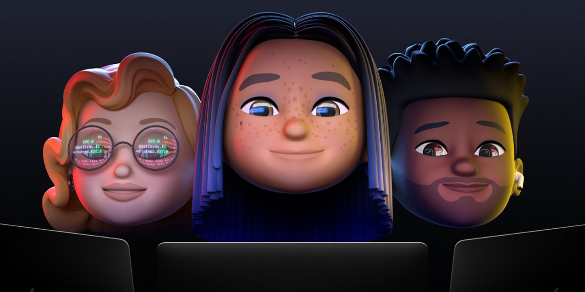

# WWDC 2020 - Swift Student Challenge

List of student submissions for the WWDC 2020 - Swift Student Challenge. The list is in alphabetical order.

### How to add your submission?
1. **[Click here to open the form](https://github.com/wwdc/2020/issues/new?template=submit.yml)** and fill it in.
2. Send it. A bot checks your entry within a minute and tells you if anything needs fixing. You can edit the form after sending.
3. When it is approved your entry appears on this list.

#### How to update or remove your submission?
Use the **[update form](https://github.com/wwdc/2020/issues/new?template=update.yml)**. Only the person who sent the entry can change it.

### Submissions

| Participant | Links | Status |
|:--|:--|:--|
| [Ailton Vieira Pinto Filho](https://twitter.com/ailtonvivaz) | [GitHub](https://github.com/ailtonvivaz/WWDC20Playground) · [Video](https://youtu.be/Epffk-v0Oww) UIKit |  |
| [Albert Rayneer Queiroz](https://www.instagram.com/albertqueiroz_/) | [GitHub](https://github.com/AlbertQueiroz/MagicFlute-WWDC20) · [Video](https://www.youtube.com/watch?v=eYtamPAZ4p0) UIKit, AVFoundation |  |
| [Alexander Zank](https://twitter.com/AlexLikePlus) | [GitHub](https://github.com/AlexLike/WWDC20Playground) · [Video](https://youtu.be/k_1tqM6LmV0) SwiftUI, SceneKit, Accelerate, ARKit |  |
| [Alexandru Turcanu](https://github.com/Pondorasti) | [GitHub](https://github.com/Pondorasti/SimonDraws) · [Video](https://youtu.be/KyiXl2NFWHg) SwiftUI, PencilKit, CoreML, AVFoundation |  |
| [Aline Gomes de Brito](https://www.linkedin.com/in/aline-gomes-de-brito-379564165/) | [GitHub](https://github.com/gomesalineagb/wwdc2020) · [Video](https://www.youtube.com/watch?v=Z-21mbX28VE) SpriteKit, AVFoundation |  |
| [Alkan Caner](https://github.com/AlkanCaner) | [GitHub](https://github.com/AlkanCaner/InteractivePicture) · [Video](https://www.youtube.com/watch?v=Ght67Ks1Wtg) SwiftUI |  |
| [Alvin Hsueh](https://www.instagram.com/qazqwe0922/) | [GitHub](https://github.com/HaXAlvin/WWDC20) SpriteKit, Foundation, UIKit |  |
| [Amit Samant](https://www.linkedin.com/in/amitsamant-dev/) | [GitHub](https://github.com/DominatorVbN/WWDC20-Submission) · [Video](https://youtu.be/dsosgiPSXdo) SwiftUI, CoreAnimation, SceneKit, ARKit |  |
| [Antônio Carlos](https://www.linkedin.com/in/ant%C3%B4nio-carlos-corr%C3%AAa-neto-j%C3%BAnior-4a753816b/) | [GitHub](https://github.com/AntonioCarlosCNJ/WWDC_2020) · [Video](https://www.youtube.com/watch?v=cl3Ou7SgQn4) SpriteKit |  |
| [Anya Sliwinski](https://a-n-y-a.github.io) | [GitHub](https://github.com/a-n-y-a/virus-spread-sim) SpriteKit |  |
| [Arjun Dureja](https://www.instagram.com/arjun874) | [GitHub](https://github.com/Arjun-dureja/WWDC-Swift-Student-Challenge) · [Video](https://www.youtube.com/watch?v=5zoE_7nQ1N4) UIKit |  |
| [Artemas J. Radik](https://www.instagram.com/aj_radik/) | [GitHub](https://github.com/magnesiumm/WWDC20-Swift-Student-Challenge) UIKit |  |
| [Arved Viehweger](https://twitter.com/arvedviehweger) | [Video](https://www.youtube.com/watch?v=y7FjFwVwM08&feature=youtu.be) ARKit, SceneKit, UIKit, AVFoundation |  |
| [Aryan Nambiar](https://twitter.com/ifisq) | [GitHub](https://github.com/ifisq/Build-A-Piano) UIKit, AVFoundation |  |
| [Askar Almukhametov](https://www.instagram.com/almaskar29_09/) | [GitHub](https://github.com/MetahCoder/Dombra_playground) UIKit, AVFoundation |  |
| [Ataberk Turan](https://twitter.com/ataberk_trn) | [GitHub](https://github.com/ataberkturan/LalopathyAI) SwiftUI, CoreML, Combine |  |
| [Aurther Nadeem](https://www.instagram.com/aurther_nadeem/) | [GitHub](https://github.com/Aurther-Nadeem/WWDC2020) ARKit, RealityKit, SwiftUI, AVFoundation |  |
| [Bartłomiej Pluta](https://github.com/bpluta) | [GitHub](https://github.com/bpluta/Artyficial-Camera) SwiftUI, CoreML, AVFoundation |  |
| [Baskoro Indrayana](https://github.com/baskoroi) | [GitHub](https://github.com/baskoroi/wwdc20-submission) · [Video](https://youtu.be/pU6q3clW3w8) SwiftUI, Combine |  |
| [Benjamin Hutter](https://www.instagram.com/benjaminhtr/) | [GitHub](https://github.com/benjaminhtr/WWDC20) UIKit, CoreML, Vision, AVFoundation |  |
| [Benji Burgess](https://twitter.com/benjjiburgess) | [GitHub](https://github.com/benjiburgess/WWDC20-Scholarship) SwiftUI |  |
| [Berkin Ceylan](https://twitter.com/BerkinCeylan) | [GitHub](https://github.com/berkinceylan/WWDC20) · [Video](https://www.youtube.com/watch?v=uN7Ea_Ihduw) SwiftUI |  |
| [Bradley Klemick](https://bradztech.com) | [GitHub](https://github.com/BradzTech/GravityPlayground) SpriteKit |  |
| [Brian Supatra](https://github.com/briansupatra) | [GitHub](https://github.com/briansupatra/WWDC2020) UIKit |  |
| [Bruno Pastre](https://instagram.com/pastresome) | [GitHub](https://github.com/pastre/wwdc2020) · [Video](https://www.youtube.com/watch?v=5ewAP9lBV40) SpriteKit |  |
| [Bryanza Novirahman](https://twitter.com/bnrvideos) | [GitHub](https://github.com/bryanzanr/go-cli) · [Video](https://www.youtube.com/watch?v=yIZjEuULFos) SwiftUI |  |
| [BumMo Koo](https://twitter.com/gbmksquare) | [GitHub](https://github.com/gbmksquare/WWDC-2020) SceneKit, AVFoundation, PencilKit |  |
| [Caio Noronha](https://www.linkedin.com/in/caio-noronha-435745168/) | [GitHub](https://github.com/CaioNoronha/DanceChallenge) · [Video](https://www.youtube.com/watch?v=Gfo8tdN4iP8) SpriteKit, AVFoundation |  |
| [Cameron Bernhardt](https://twitter.com/AstroCB) | [GitHub](https://github.com/AstroCB/Swift-COVID) AppKit, MapKit |  |
| [Can Balkaya](https://twitter.com/canbalkya) | [GitHub](https://github.com/canbalkya/Evape-WWDC20) · [Video](https://www.youtube.com/watch?v=QMQnLFypW3Y) SwiftUI |  |
| [Carlo Palumbo](https://www.linkedin.com/in/carlo-palumbo-992358111/) | [GitHub](https://github.com/patana93/Let-s-Play-With-Digital-Electronics-WWDC20) · [Video](https://youtu.be/YgoyxPCzjss) UIKit |  |
| [Carlos Modinez](https://www.linkedin.com/in/carlos-modinez/) | [GitHub](https://github.com/CarlosModinez/SmartTraffic-WWDC2020) · [Video](https://www.youtube.com/watch?v=FQvwIVXCQus) SpriteKit |  |
| [Cay Zhang](https://github.com/Cay-Zhang) | [GitHub](https://github.com/Cay-Zhang/SwiftStudentChallenge2020) · [Video](https://youtu.be/A7TtfZyYo3A) SpriteKit, Combine |  |
| [Chong Zhuang Hong](https://github.com/ZhuangHong-C/wwdc21_brainstorm) | SpritKit, AVFoundation, CoreML |  |
| [Christian P](https://twitter.com/Priva2804) | [GitHub](https://github.com/Priva28/PlanetARium) · [Video](https://youtu.be/EwPspV8ZUp4) SwiftUI, ARKit, SceneKit, Vision |  |
| [Cristian Garske](https://cristiangars.com) | [GitHub](https://github.com/CristianGarske/WWDC20) · [Video](https://youtu.be/kPVHToiKMJM) SwiftUI |  |
| [Daniel (Shao Cheng) Pan](https://github.com/Majestic-Hero) | [GitHub](https://github.com/Majestic-Hero/WWDC-2020-Submission) · [Video](https://www.youtube.com/watch?v=eyAY9Dkrsak) SpriteKit, UIKit |  |
| [Daniel Leal](https://github.com/danielleal2901) | [GitHub](https://github.com/danielleal2901/WWDC_Dyslexia_2020) SpriteKit |  |
| [Daniel Liu](https://liudaniel.com/) | [GitHub](https://github.com/Daniel-Liu-c0deb0t/WWDC-2020-Coronavirus-Comparison) · [Video](https://youtu.be/X12SKO0wGwg) UIKit |  |
| [Daniil Dolog](https://github.com/DanDolog) | [GitHub](https://github.com/DanDolog/wwdc2020-Accepted-) · [Video](https://youtu.be/5EBop-H8d6A) SpriteKit, UIKit, AVFoundation |  |
| [Dave Jha](https://www.davejha.me) | [GitHub](https://github.com/DaveJha/Social-Distancing-Simulator) · [Video](https://youtu.be/WlbHsg09BxY) SwiftUI, SpriteKit |  |
| [David Knothe](https://github.com/knothed) | [GitHub](https://github.com/knothed/Fractals) CoreAnimation |  |
| [Deniz Karakay](https://www.instagram.com/sedna_karakay) | [GitHub](https://github.com/dkarakay/Stop-Pandemic) · [Video](https://youtu.be/oOy-9lieXxk) SpriteKit, AVFoundation, SwiftUI |  |
| [Devi Mandasari](https://www.instagram.com/devimandas14) | [GitHub](https://github.com/devimandas/WWDC20-Gonggong) · [Video](https://www.youtube.com/watch?v=DNXkG2Ow4ZY) SpriteKit, AVFoundation |  |
| [Dicky Geraldi](https://github.com/dickygeraldi/) | [GitHub](https://github.com/dickygeraldi/WWDC-2020-Dicky-Geraldi) UIKit, AVFoundation |  |
| [Duraid Abdul](https://twitter.com/duraidabdul/) | [GitHub](https://github.com/duraidabdul/Sleep) UIKit, SwiftUI, CoreMotion |  |
| [Edgar Vilchis](https://twitter.com/edgarvil96) | [GitHub](https://github.com/Evil96/WWDC) · [Video](https://www.youtube.com/watch?v=uvENDZJteiI) UIKit, CoreML |  |
| [Euan Traynor](https://twitter.com/EuanFTraynor) | [GitHub](https://github.com/efalloon/WWDC2020-Accepted) UIKit, AVFoundation |  |
| [Evgenii Truuts](http://linkedin.com/in/g7skim) | [GitHub](https://github.com/g7skim/SaveTheCells) · [Video](https://www.youtube.com/watch?v=nyORlZUlxgs) SpriteKit, SceneKit |  |
| [Federico Ciardi](https://github.com/fedeci) | [GitHub](https://github.com/fedeci/WWDC2020) SpriteKit, AVFoundation |  |
| [Fernando Fontecha](http://ferfontecha.com) | [Video](https://www.youtube.com/watch?v=zi2J60IKbKw) UIKit, CoreAnimation, PlaygroundSupport |  |
| [Frank Foster](https://twitter.com/frankefoster) | [GitHub](https://github.com/analogpotato/WWDCSubmission) AVFoundation, Vision, VisionKit |  |
| [Fred P](https://github.com/fredpi) | [GitHub](https://github.com/fredpi/WWDC2020) UIKit, CoreAnimation, CoreGraphics |  |
| [Frederico Lacis](https://github.com/fredlacis) | [GitHub](https://github.com/fredlacis/TheSeaCycle_WWDC2020) · [Video](https://www.youtube.com/watch?v=f_y6uGfQxcI) SpriteKit |  |
| [Giovanni Gorgone](https://linkedin.com/in/giovanni-gorgone) | [GitHub](https://github.com/ggorgone/WWDC2020_submission) SwiftUI, AVFoundation |  |
| [Gleb Losev](https://t.me/higleb) | [GitLab](https://gitlab.com/hellokurt/dyslexiareader) UIKit, AVFoundation |  |
| [Glenn Brannelly](http://glennbrannelly.com/) | [Video](https://youtu.be/lQAr6TQetm4) SpriteKit, SceneKit |  |
| [Grant Emerson](https://github.com/GrantJEmerson/) | [GitHub](https://github.com/GrantJEmerson/Clipstrument) · [Video](https://youtu.be/VWTPXvdipn0) UIKit, AVFoundation |  |
| [Grey Patterson](https://greypatterson.me) | [GitHub](https://github.com/grey280/SwiftLife) SwiftUI, Combine |  |
| [Haotian Zheng](http://fincher.im/) | [GitHub](https://github.com/JustinFincher/WWDC20Playground) UIKit Dynamics, SwiftUI, SpriteKit |  |
| [Hariharan Murugesan](https://hariharanm.com/) | ARKit &amp; SceneKit |  |
| [Hengyu Liu](https://www.instagram.com/a211212abc/) | [GitHub](https://github.com/a211212abc/WWDC20) SwiftUI, ARKit, SpriteKit |  |
| [Henrik Storch](https://twitter.com/thisisthefoxe) | [GitHub](https://github.com/thisIsTheFoxe/WWDC20) SpriteKit |  |
| [Henrique Conte](https://www.instagram.com/henriquecontee/) | [GitHub](https://github.com/henriqueconte/ESCapeEleanorWWDC20-Accepted) · [Video](https://www.youtube.com/watch?v=inrIAAM6OCI&feature=youtu.be) TouchBar, SpriteKit, AVFoundation, AppKit |  |
| [Hock Shem Chong](https://github.com/hockshem) | [GitHub](https://github.com/hockshem/multiply-by-lines) UIKit, PencilKit, Vision |  |
| [Ihwan D](https://ihwan.id) | [GitHub](https://github.com/IhwanID/wwdc20-rice-cooker-hack) · [Video](https://youtu.be/0fgdYEAn6MQ) SwiftUI, AVFoundation |  |
| [Izabella Melo](https://izmcm.github.io/) | [GitHub](https://github.com/izmcm/Cracking-The-Enigma) UIKit |  |
| [Jackson Utsch](https://github.com/JacksonUtsch) | [GitHub](https://github.com/JacksonUtsch/WWDC-2020-Project%20) SwiftUI, SpriteKit |  |
| [Jaesung Lee](https://github.com/jaesung-wwdc) | [GitHub](https://github.com/jaesung-wwdc/WWDC20-SwiftStudentChallenge) ARKit, SceneKit, UIKit, AVFoundation |  |
| [Jake Spann](https://twitter.com/JakeS3231) | [GitHub](https://github.com/Jake3231/Cybersecurity-101) SpriteKit |  |
| [Jalp Desai](https://github.com/jalp14/WWDC20) | SwiftUI, SpriteKit, UIKit |  |
| [Jannik Schwade](https://twitter.com/jannik_schwade) | [GitHub](https://github.com/jannikschwade/wwdc20) · [Video](https://www.youtube.com/watch?v=bY32gZBbTS8) SpriteKit, UIKit |  |
| [Javier Gallo Roca](https://www.javiergalloroca.com) | [GitHub](https://github.com/Happygallo/ColorEmotionsPalette) · [Video](https://youtu.be/f0-avTA32Yg) SwiftUI |  |
| [João Gabriel](https://twitter.com/joogps) | [GitHub](https://github.com/joogps/WWDC-2020) · [Video](https://youtu.be/cf-_kp-4W48) SpriteKit, AVFoundation |  |
| [João Paulo Santos](https://www.linkedin.com/in/joao-ppsantos/) | [GitHub](https://github.com/jppsantos/WWDC_EmpathyChallenge) · [Video](https://www.youtube.com/watch?v=8C5BjjiLf5Y) SpriteKit, GameplayKit |  |
| [John Atkinson](https://johnatkinson.net/trophy-case/swift-student-challenge) | SpriteKit |  |
| [Jose Adolfo Talactac](https://twitter.com/joseadolfot) | [GitHub](https://github.com/jadolfot/LearnWithAR) · [Video](https://www.youtube.com/watch?v=vNZKRVPVzX4) ARKit, SceneKit, SpriteKit, simd |  |
| [Joseph Kokenge](https://www.instagram.com/jokokrispy/) | [GitHub](https://github.com/JOyo246/SwiftStudentChallengeSubmission2020) · [Video](https://www.youtube.com/watch?v=L2JxtWiTg5I) CryptoKit, UIKit |  |
| [Julian Benedikt Heuschen](https://twitter.com/HeuschenJ) | [GitHub](https://github.com/JavaJHMalerBus/wwdc20) CoreML, Vision, AVFoundation |  |
| [Julian Schiavo](https://twitter.com/_julianschiavo) | [GitHub](https://github.com/julianschiavo/wwdc/tree/master/2020) · [Video](https://www.youtube.com/watch?v=-m74x10IZS4) ARKit, Combine, RealityKit, SwiftUI |  |
| [Kanishka Chaudhry](https://www.instagram.com/ralaasi/) | [GitHub](https://github.com/Kanishka3/SwiftStudentChallenge2020) · [Video](https://youtu.be/G87_5RRhB9g) SwiftUI, UIKit, AVFoundation, Combine |  |
| Keith Madison | [Video](https://www.youtube.com/watch?v=D68MrqDGYAI) UIKit, AVFoundation, NaturalLanguage, CoreML |  |
| [Kellyane Nogueira](https://www.instagram.com/kellyanenogueira1/) | [GitHub](https://github.com/kellyanenogueira1/WWDC-Submission) · [Video](https://www.youtube.com/watch?v=lTV0syBmcCI) UIKit |  |
| [Liam Rosenfeld](https://liamrosenfeld.com) | [GitHub](https://github.com/liamrosenfeld/STFourierExplainer) Accelerate, AVFoundation, CoreGraphics, SwiftUI |  |
| [LiulietLee](https://github.com/LiulietLee) | [GitHub](https://github.com/LiulietLee/nn-playground) SwiftUI, Combine, Metal Performance Shaders |  |
| [Louise P.](https://github.com/lpieri) | [GitHub](https://github.com/lpieri/Meep) SpriteKit, AVFoundation |  |
| [Manas Malla](https://twitter.com/manas_malla_) | [GitHub](https://github.com/ManasMalla/BeCoronaReady) · [Video](https://www.youtube.com/watch?v=gwEmnXVhckw) PlaygroundSupport, PlaygroundBook, SceneKit, UIKit |  |
| [Manthan Keim](http://manthankeim.tech) | [GitHub](http://github.com/ManthanKeim/COVID19-Learner-Game) · [Video](https://youtu.be/ICt1kXr78uQ) UIKit, GameplayKit, AVFoundation, AudioToolbox |  |
| [Maria Fernanda Azolin](https://www.instagram.com/mfernanda_azolin/) | [GitHub](https://github.com/azolinmf/aPathToTheLight-playgroundBook) · [Video](https://www.youtube.com/watch?v=p7y_d-d1B-0) SpriteKit, UIKit |  |
| [Mariana Beilune Abad](https://www.linkedin.com/in/mariana-abad/) | [GitHub](https://github.com/maaryhabad/armenia) · [Video](https://www.youtube.com/watch?v=G4w_gSMjiyQ) SceneKit |  |
| [Marlon Lückert](https://twitter.com/marlon360) | [GitHub](https://github.com/marlon360/wwdc20-submission) · [Video](https://www.youtube.com/watch?v=Yvs1eFle1sc) SwiftUI, CoreML, PencilKit, ARKit |  |
| [Matheus Andrade](https://www.linkedin.com/in/matheus-andrade-27592b196/) | [GitHub](https://github.com/matheusvtna/TheBlindMaze) SpriteKit |  |
| [Matheus Fogiatto](https://www.instagram.com/matheus.fogiatto) | [GitHub](https://github.com/matheusfogiatto/TheHealthJourney) · [Video](https://youtu.be/OtrIBNOJ2AE) SpriteKit |  |
| [Matheus Gois](https://github.com/MaatheusGois) | [Video](https://youtu.be/C80ta0EaklA) UIKit, SpriteKit |  |
| [Matt Free](https://github.com/MJFree34/) | [GitHub](https://github.com/MJFree34/MusicChordTeacher/) AVFoundation, UIKit |  |
| [Maxime Madrau](https://www.instagram.com/maxmad682) | [GitHub](https://github.com/Maxmad68/SwiftStudentChallenge2020) SpriteKit, PencilKit |  |
| [Michał Cichecki](https://linkedin.com/in/mcichecki/) | [GitHub](https://github.com/mcichecki/emoji-rebus) AppKit, AVFoundation, SpriteKit |  |
| [Mike Ovyan](https://github.com/ovyan) | [GitHub](https://github.com/ovyan/graph_path) UIKit |  |
| [Min Seong Kang](https://github.com/mkang30) | [GitHub](https://github.com/mkang30/GravityBalling) SceneKit, SpriteKit |  |
| [Minhyuk Kim](https://github.com/mininny) | [GitHub](https://github.com/mininny/RockPaperScissors-WWDC20) ARKit, CoreML, Vision, UIKit |  |
| [Minji Lee](https://www.instagram.com/mindi_minji_manju) | [GitHub](https://github.com/manju-minji/wwdc20) UIKit, AVFoundation |  |
| [Mishaal Kandapath](https://www.instagram.com/okmishaal/) | [GitHub](https://github.com/ecomparer/TheBeeDance/) · [Video](https://youtu.be/jHNd48k0YPE) ARKit, SpriteKit, SceneKit, SwiftUI |  |
| [Mohamed Salah](https://mohasalah.com) | [GitHub](https://github.com/mohasalahh/WWDC20-Scholarship-Submission) · [Video](https://youtu.be/-EOhFATLLt8) SceneKit, ARKit, UIKit |  |
| [Muhammad Arif Setyo Aji](https://www.linkedin.com/in/arifsetyoaji18/) | UIKit |  |
| [Muhammad Dary Azhari](https://primyindonesia.com) | [Video](https://youtu.be/2s-Loc5hTMY) AVFoundation, UIKit |  |
| [Muhammad Ilham Ashiddiq Tresnawan](https://www.instagram.com/ilham_ashiddiq/) | SpriteKit |  |
| [Murilo Teixeira](https://www.linkedin.com/in/murilot/) | [Video](https://youtu.be/uJfihjMoCxg) SpriteKit, GKStateMachine, NSTouchBar |  |
| [Nalin Bhardwaj](https://nibnalin.me) | SwiftUI, SpriteKit, CoreML |  |
| [Naman Bishnoi](https://naman.rocks/) | [GitHub](https://github.com/diabloxenon/Swiftspam) · [Video](https://youtu.be/w2bR5VMJ9CE) SwiftUI, CoreGraphics, Foundation |  |
| [Naman Jain](https://twitter.com/nxmxnjxxn) | [GitHub](https://github.com/naman17/WWDC-SSC) UIKit, SpriteKit, CoreML, CoreAnimation |  |
| [Nathaniel Fargo](https://paradox42.tech) | [GitHub](https://github.com/theParadox42/Black-Holes/tree/swift-project) CoreGraphics, SwiftUI, GKNoise |  |
| [Niall Kehoe](https://twitter.com/Niall_Kehoe) | [Video](https://www.youtube.com/watch?v=nbuuas18zgA) ARKit, CoreML, CreateML, SpriteKit |  |
| [Niklas Bülow](https://twitter.com/NiklasBuelow) | [GitHub](https://github.com/insightmind/WWDC20SwiftStudentChallenge) SpriteKit, CoreImage, SIMD |  |
| [Oksana Bolibok](https://github.com/Rok-sana) | [GitHub](https://github.com/Rok-sana/WWDC2020-Logic-Board) · [Video](https://youtu.be/O0DEpSXNaI8) SpriteKit, UIKit, AVSpeechSynthesizer, AVFoundation |  |
| [Oscar Gorog](https://twitter.com/OscarGorog) | [GitHub](https://github.com/OscarGorog/WWDC20-Playground) SpriteKit, SceneKit, ARKit, CoreML |  |
| [Oskar Chybowski](https://github.com/Oschly) | [GitHub](https://github.com/Oschly/SSC20_Submission) UIKit |  |
| [Ozan Mirza](http://ozanmirza1.github.io/) | [GitHub](https://github.com/ozanmirza1/WWDC-2020-Game-Theory) · [Video](https://youtu.be/tvPu4AGlc_I) Foundation, AVFoundation, UIKit, QuartzCore |  |
| [Ozawn Mirza](http://ozanmirza1.github.io/) | [GitHub](https://github.com/ozanmirza1/WWDC-2020-Game-Theory) · [Video](https://youtu.be/tvPu4AGlc_I) Foundation, AVFoundation, UIKit, QuartzCore |  |
| [Palle Klewitz](https://github.com/palle-k) | [GitHub](https://github.com/palle-k/WWDC20) SwiftUI, Accelerate |  |
| [Patricia Sampaio](https://www.linkedin.com/in/patr%C3%ADcia-sampaio-5a580919a/) | [GitHub](https://github.com/patysiq/hinadan) SpriteKit, Foundation |  |
| [Peter Yaacoub](https://twitter.com/yaapete) | [GitHub](https://github.com/Yaacoub/Swift-Student-Challenge) AVFoundation, UIKit |  |
| [Poppy Hwangsa Iswara](https://www.linkedin.com/in/poppy-hwangsa-iswara-8139a1188/) | [GitHub](https://github.com/ppyrinn/WWDC20Playground) AVFoundation, CreateML, SoundAnalysis, SpriteKit |  |
| [Prajwal Kulkarni](https://www.instagram.com/prajwalkulkarni_/) | [GitHub](https://github.com/prajwalkulkarni/wwdc2020) · [Video](https://www.youtube.com/watch?v=VaLJvLJuMFM) SwiftUI, SpriteKit |  |
| [Pranath Reddy](https://www.linkedin.com/in/pranath-reddy/) | [GitHub](https://github.com/PyJedi/WWDC20-SwiftStudentChallenge) UIKit, CoreML, CoreGraphics, Vision |  |
| [Pranav Karthik](https://twitter.com/code_pranav) | [GitHub](https://github.com/pranavkarthik10/exercisAR) · [Video](https://youtu.be/SYeBaYsg_ZY) UIKit, ARKit, Foundation |  |
| [Praveen Balakrishnan](https://github.com/xp3d1) | [GitHub](https://github.com/xp3d1/Swift-Student-Challenge-Entry) · [Video](https://youtu.be/gsDKYLWAMpU) SwiftUI, SceneKit, AVFoundation |  |
| [Pushpinder Pal Singh](https://github.com/pushpinderpalsingh) | [GitHub](https://github.com/pushpinderpalsingh/CyberSense-WWDC20) UIKit |  |
| [Rafael Ferreira](https://github.com/Rafaelfferreira) | [GitHub](https://github.com/Rafaelfferreira/DiseaseSimulator) UIKit |  |
| [Rafael Galdino](https://www.linkedin.com/in/rafael-galdino/) | [GitHub](https://github.com/Galdineris/2020) Foundation, SpriteKit |  |
| [Rangel Dias](https://www.linkedin.com/in/rangel-dias-016575b7/) | [GitHub](https://github.com/rangelterraquio/WWDC2020) SpriteKit |  |
| [Renan Magagnin](https://www.instagram.com/renanmagagnin/) | [GitHub](https://github.com/renanmagagnin/beat-wwdc20) · [Video](https://youtu.be/ayVB08sXtZY) SpriteKit, AVFoundation |  |
| [Renata Faria](http://renatafariagomes.wordpress.com/) | [GitHub](https://github.com/xReee/WWDC2020) · [Video](https://www.youtube.com/watch?v=fZ3ilbJx5_8) UIKit, GameplayKit, AVKit |  |
| [Rifqi R](http://rifqi.id/) | [GitHub](https://github.com/rif2d/dubsub20) · [Video](https://youtu.be/rS2Ln-JC-yQ) SpriteKit, GameplayKit |  |
| [Ritesh Kanchi](https://github.com/ritesh-kanchi/) | [GitHub](https://github.com/ritesh-kanchi/WWDC20-Submission) SwiftUI |  |
| [Robert Pliev](https://github.com/camotsuc) | [GitHub](https://github.com/camotsuc/wwdc20ChallengeAttempt) UIKit, Foundation |  |
| [Rodrigo Giglio](https://www.instagram.com/rodrigowoulddo/) | [GitHub](https://github.com/rodrigowoulddo/WWDC-2020-The-Bacteria-Adventure) · [Video](https://youtu.be/odCptJ5_-_E) SpriteKit |  |
| [Roland Schmitz](https://www.linkedin.com/in/roland-schmitz-8683766/) | [GitHub](https://github.com/roland-schmitz-academy/WWDC20-SpiralField) SwiftUI |  |
| [Roman Esin](https://twitter.com/EsinRomanSwift) | [Video](https://youtu.be/CZyZTzmclFs) UIKit |  |
| [Roman Rakhlin](https://www.instagram.com/rrakhlin/) | [GitHub](https://github.com/romarakhlin/WWDC20-Submission) · [Video](https://www.youtube.com/watch?v=i3y5k_khW_I) UIKit, SceneKit, SpriteKit |  |
| [Roy Rao](https://github.com/RoyRao2333) | [GitHub](https://github.com/RoyRao2333/WWDC20-Scholarship) Cocoa, Security, PlaygroundSupport |  |
| [Sabesh Bharathi](https://twitter.com/sabeshbharathi) | [GitHub](https://github.com/programVeins/Pandemic) · [Video](https://www.youtube.com/watch?v=_wSukFJu3I4) UIKit, AVFoundation |  |
| [Sai Ranga Reddy](https://twitter.com/irangareddy) | [GitHub](https://github.com/irangareddy/SwiftUI-Trends) · [Video](https://youtu.be/4ZkhOWVz00I) SwiftUI |  |
| [Sai Vivek Amirishetty](https://twitter.com/SAI_VIVEK_) | [GitHub](https://github.com/vivekboss99/WWDC-2020) UIKit |  |
| [Soumyaditya Choudhuri](https://www.linkedin.com/in/soumchoudhuri/) | [GitHub](https://github.com/soum-c) UIKit |  |
| [Sufiandy Elmy](https://github.com/elmysf) | [GitHub](https://github.com/elmysf/DisinfectantAttackCovid-19) SpriteKit |  |
| [SungJin Yang](https://www.youtube.com/channel/UCNBMe807H4SV3iSzX7s1bAw) | [GitHub](https://github.com/CoderLoveMath) SpriteKit, UIKit |  |
| [Swapnanil Dhol](https://twitter.com/SwapnanilDhol) | [GitHub](https://github.com/SwapnanilDhol/Strokes) · [Video](https://www.youtube.com/watch?v=2k72tGpKbpo) ARKit, RealityKit, CoreML, CreateML |  |
| [Sylvain Guillier](http://sylvainguillier.com) | [Video](https://youtu.be/p1fMYYKdKQo) SwiftUI, UIKit, SpriteKit, AVFoundation |  |
| [Thiago Martins](https://www.linkedin.com/in/thiago-martins-0506/) | [GitHub](https://github.com/ThiagoMartins05/The-Golden-Ratio-WWDC2020) SpriteKit |  |
| [Thiago Nitschke](https://www.linkedin.com/in/thiago-nitschke-sim%C3%B5es-844a88b6/) | [GitHub](https://github.com/thnitschke/WWDC2020) SwiftUI |  |
| [Thijs van der Heijden](https://twitter.com/thijsheijden) | [GitHub](https://github.com/thijsheijden/WWDC20) UIKit |  |
| [Til Blechschmidt](https://github.com/TilBlechschmidt) | [GitHub](https://github.com/TilBlechschmidt/BoidsPlayground) · [Video](https://youtu.be/dcuUWqUO91w) Metal, SwiftUI, AVFoundation |  |
| [Uladzislau Tarasevich](https://github.com/Sencudra) | [GitHub](https://github.com/Sencudra/WWDC-2020) · [Video](https://youtu.be/-gmsWnv3UZ8) SpriteKit, AVFoundation |  |
| [Umar Haroon](https://twitter.com/umar__haroon) | [GitHub](https://github.com/Umar-M-Haroon/WWDC2020) ARKit, SceneKit, SwiftUI, UIKit |  |
| [Valentin Silvera](https://valentin.work) | [GitHub](https://github.com/valentinsilvera/wwdc2) · [Video](https://www.youtube.com/watch?v=LXJv-Knsdao) SpriteKit |  |
| [Valentino Cerutti](https://twitter.com/micrograx) | [GitHub](https://github.com/Micrograx/Emotions-WWDC20) SwiftUI, AVFoundation |  |
| [Veit Progl](https://twitter.com/VoxelVoxels) | [GitHub](https://github.com/Veeit/WWDC-2020-Learning-Disability) · [Video](https://youtu.be/8qhFrv4MEPg) SwiftUI, SceneKit, ARKit, CoreML |  |
| [Victor S. Melo](https://www.linkedin.com/in/vsmelo/) | [GitHub](https://github.com/vctrsmelo/WWDC20) · [Video](https://youtu.be/ov_U4okydMo) SwiftUI, AI |  |
| [Vincent Cai](https://vince14genius.github.io/) | [GitHub](https://github.com/Vince14Genius/WWDC20-Wotagei-x-Music-Game) SpriteKit, SwiftUI, SKShader (OpenGL/GLSL) |  |
| [Vinícius Bernardes Bonemer](https://www.linkedin.com/in/vbonemer) | [GitHub](https://github.com/viniciusbonemer/Swift-Student-Challenge-2020) · [Video](https://www.youtube.com/watch?v=PBUt_Ra_MH8&feature=youtu.be) UIKit, SpriteKit, Combine, AVFoundation |  |
| [Vinícius Binder](https://www.linkedin.com/in/viniciusbinder/) | [GitHub](https://github.com/viniciusbinder/wwdc20-submission) · [Video](https://youtu.be/f_LbK6Dhfps) SpriteKit |  |
| [Vinicius Chagas](https://github.com/vcsoares/) | [GitHub](https://github.com/vcsoares/FourierAndMusic) · [Video](https://youtu.be/fZsP1-hPrt0) SwiftUI, AVFoundation |  |
| [Vitória Corrêa](https://www.linkedin.com/in/vit%C3%B3ria-corr%C3%AAa-55b928186/) | [GitHub](https://github.com/vofcorrea/wwdc20wemen) SpriteKit, UIKit |  |
| [Wendy Liga](https://twitter.com/wendyliga) | [GitHub](https://github.com/wendyliga/tunery) · [Video](https://youtu.be/L17PW6inUzw) AVFoundation, UIKit |  |
| [Wenzheng "William" Du](https://insightfulaiapps.com) | [GitHub](https://github.com/InsightfulAI/AllAboutFeelings) · [Video](https://youtu.be/dNAY4NBPV8k) CoreML, UIKit, AVFoundation |  |
| [William Taylor](https://twitter.com/wfltaylor) | [Video](https://youtu.be/TKM9Sut60fs) UIKit, SceneKit, ARKit, AVFoundation |  |
| [Witek Bobrowski](https://twitter.com/witekbobrowski) | [GitHub](https://github.com/witekbobrowski/wwdc20-submission) SwiftUI |  |
| Xi Zhao | [GitHub](https://github.com/ZXXZ00/WWDC20) · [Video](https://youtu.be/RMyHlFH0348) CoreMotion, SpriteKit |  |
| [Xu Haobo](https://www.linkedin.com/in/%E6%B5%A9%E5%8D%9A-%E5%BE%90-65b392122/) | [GitHub](https://github.com/haoboxuxu) · [Video](https://youtu.be/jxMOE_OQPAY) SpriteKit, SceneKit, ARKit |  |
| [Yangyang Feng](https://cv.ifffff.cn/) | [GitHub](https://github.com/CynricFeng/Papercutting) · [Video](https://www.bilibili.com/video/BV15K4y1t75s/) AppKit, Vision, SpriteKit, AVFoundation |  |
| [Yauheni Stsefankou](https://www.instagram.com/stefjen07/) | [GitHub](https://github.com/stefjen07/WWDC20-AirportLife) SpriteKit |  |
| [Yihan Huang](https://busybunny.xyz/) | [GitHub](https://github.com/GetToSet/ArtOfAscii) AVFoundation, Accelerate, UIKit |  |
| [YiZhong Qi](https://github.com/qyz777) | [GitHub](https://github.com/qyz777/AcousticShip) AVFoundation, UIKit |  |
| [Yow Shin Liou](https://www.instagram.com/yo_zn/) | [GitHub](https://github.com/yozn/wwdc20) · [Video](https://youtu.be/qHv2Xpb3tdQ) SpriteKit, AVFoundation, UIKit |  |
| [Yugantar Jain](https://github.com/yugantarjain) | [GitHub](https://github.com/yugantarjain/WWDC20) UIKit, SpriteKit Particles |  |
| [Zafar Ivaev](https://github.com/zafarivaev) | [GitHub](https://github.com/zafarivaev/WWDC20-FigureBreaker) Combine, UIKit, SceneKit, SpriteKit |  |
| [Zhengke Xu](https://xuzhengke.cn) | [GitHub](https://github.com/ixzk/Spirograph) UIKit |  |
| [Zhiyu Zhu](https://github.com/ApolloZhu) | [GitHub](https://github.com/ApolloZhu/Swifty-Podcast-Editor) SwiftUI, Combine, Speech, AVFoundation |  |
| [Zijian Zhao](https://github.com/JackZhao98) | [GitHub](https://github.com/JackZhao98/Linux-Playground) SwiftUI |  |
| [Zixuan Tang](https://github.com/TonyTang2001) | [GitHub](https://github.com/TonyTang2001/SixFeetBetween_WWDC20SwiftChallenge) · [Video](https://youtu.be/sj_laBHKu6I) SwiftUI, AVFoundation |  |

##### Total: 180 | Awarded: 129
